# Book-Worm – Marketing Mix Modelling (MMM)

**Which media channels actually drive sign-ups for an online book subscription, and where should the budget go?**
An OLS marketing mix model on 152 weeks of data (Jun 2019 – Apr 2022) covering 7 media channels, own and competitor promotions, and school holidays.

## Key findings

- **Budget and impact are badly misaligned.** TV takes **52% of the media budget but drives only ~7%** of media-driven sign-ups. YouTube takes **0.7% of the budget and drives ~15%**.
- **YouTube is the most efficient channel with a statistically significant effect:** ROI **2.19** (~$16 per sign-up vs a $35 account price). TV (ROI 0.015) and Meta (0.059) are the least efficient.
- **About half of sign-ups would happen anyway:** base 52%, media 45.5%, the rest from seasonality and promotions. Competitor promotions cost **~1,100 sign-ups per week** once they moved to the higher level in Jun 2021.
- **"Double Meta & YouTube" should be two separate decisions.** Doubling both adds **+38,112 sign-ups (+18%)** over 34 weeks, but YouTube delivers 57% of the gain for 3% of the extra cost, while Meta costs ~$788 per extra sign-up.

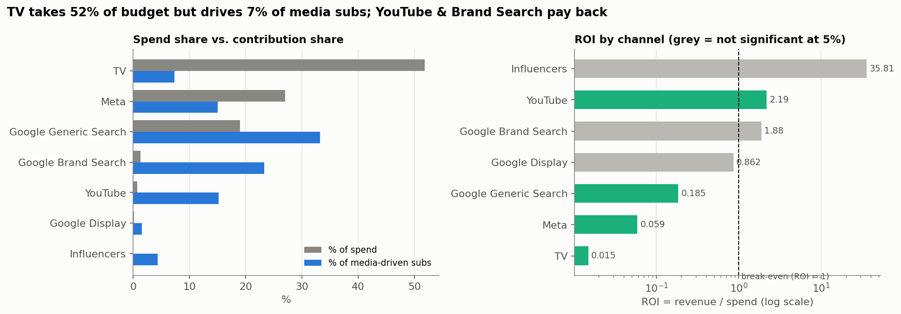

## Recommendations

| # | Recommendation | Evidence |
|---|---|---|
| 1 | Scale YouTube step by step (e.g. +50% per quarter) and re-measure | ROI 2.19; incremental ROI when doubled still 2.17 |
| 2 | Do not increase Meta; test gradual cuts | ROI 0.059; when Meta was cut in 2022, sign-ups did not fall as predicted |
| 3 | Review TV budget via a geo holdout test before cutting | ROI 0.015, but long-term brand effects may be under-measured |
| 4 | Keep Generic Search; treat Brand Search ROI (1.88) with caution | Brand Search harvests demand created by other channels |
| 5 | Match competitor promotions in peak season | Competitor promotions cost ~1,100 sign-ups/week |

## Approach

1. **Data quality:** 152 continuous weeks; found TV cost booked in weeks with zero GRP (~19% of TV cost)
2. **EDA:** trend, seasonality (July +45%), correlation, **lagged correlation** (TV peaks 4 weeks after airing → evidence for adstock), confounding between Meta/YouTube and school holidays
3. **Feature engineering:** adstock (λ = 0.9 as the brief suggests), 10-week SMA, composite digital impressions, holiday dummies
4. **Baseline models** on a time-based split (122 train / 30 test weeks), compared with naive baselines (MAPE 21.4%)
5. **Per-channel adstock:** λ = 0.9 for every channel *worsened* fit (Adj R² 0.78 → 0.69, 3 negative coefficients). Tuning λ per channel by AIC on train gave TV 0.8, Meta 0.5, Generic Search 0.0, which matches the lag evidence from EDA
6. **Final model (M3)** refit on all 152 weeks: Adj R² 0.79, MAPE 8.5%; HAC (Newey-West) standard errors for autocorrelated residuals
7. **Contribution, revenue and ROI** per channel ($35 per account)
8. **Scenario:** Meta & YouTube ×2 for May–Dec 2022, with incremental ROI per channel

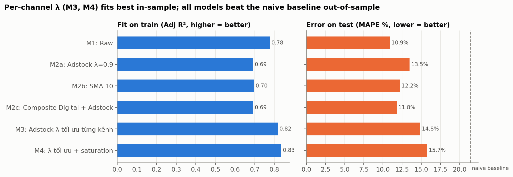

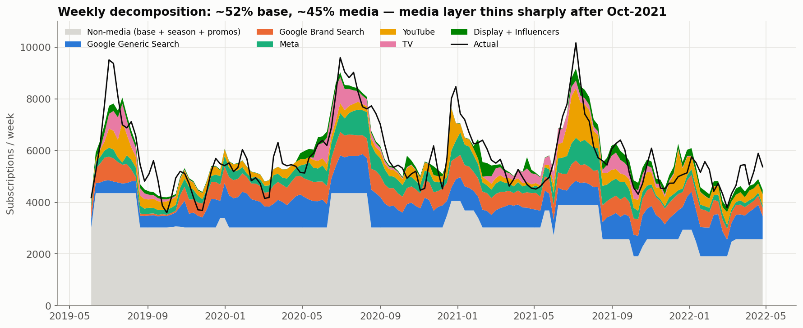

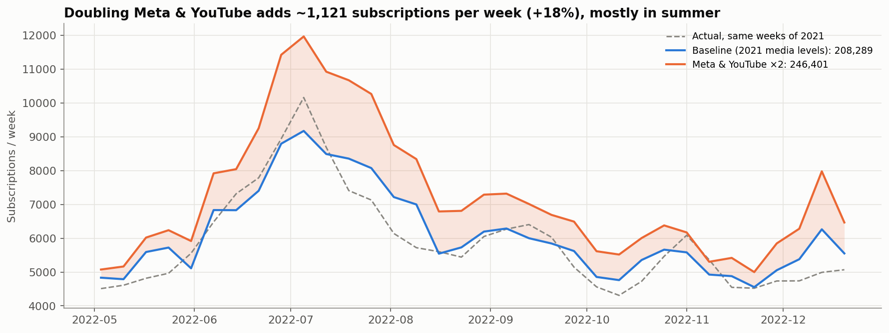

## Model checks

| Assumption | Test | Result |
|---|---|---|
| Constant variance | Breusch–Pagan | p = 0.057 → met (borderline) |
| Normal residuals | Jarque–Bera | p = 0.323 → met |
| Independent weeks | Ljung–Box / ACF | lag-1 autocorrelation 0.55 → **not met**, handled with HAC standard errors |

Out of sample, the chosen model has a MAPE of **14.8% vs 21.4%** for a historical-average baseline. M1 (raw media) forecasts better (10.9%) but has a negative Influencer coefficient and ignores carry-over, so M3 is kept for attribution, the purpose of an MMM.

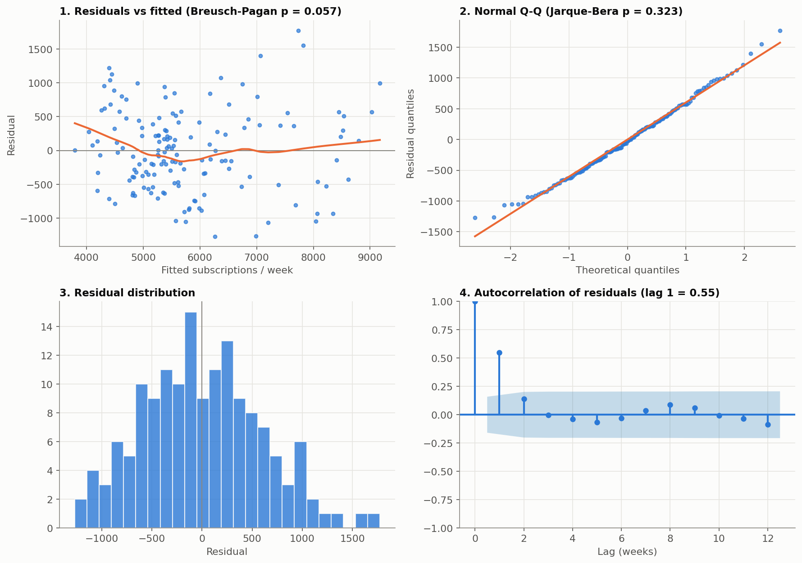

## Limitations

- Linear model: the +38k scenario is an **upper bound** (a version with diminishing returns gives +30k)
- Only 152 weeks; long-term brand effects of TV are hard to measure
- Total media ROI < 1 suggests spend may be recorded in a currency other than USD → read ROI as **relative ranking** between channels
- Influencers (p = 0.20) are not significant; Brand Search and Display are borderline (p ≈ 0.07)

<b>▶ More charts (EDA and feature engineering)</b>

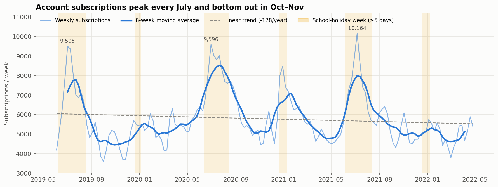
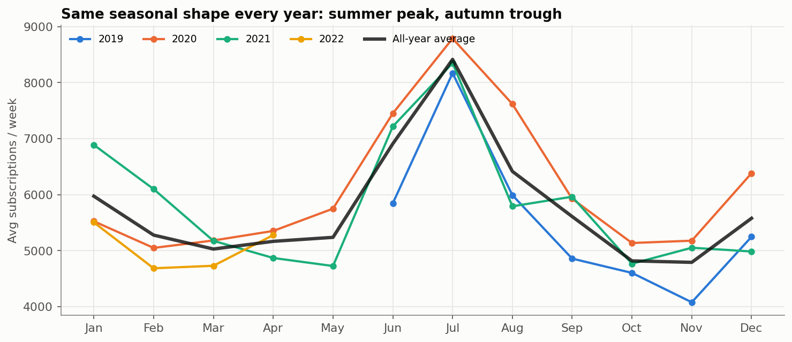
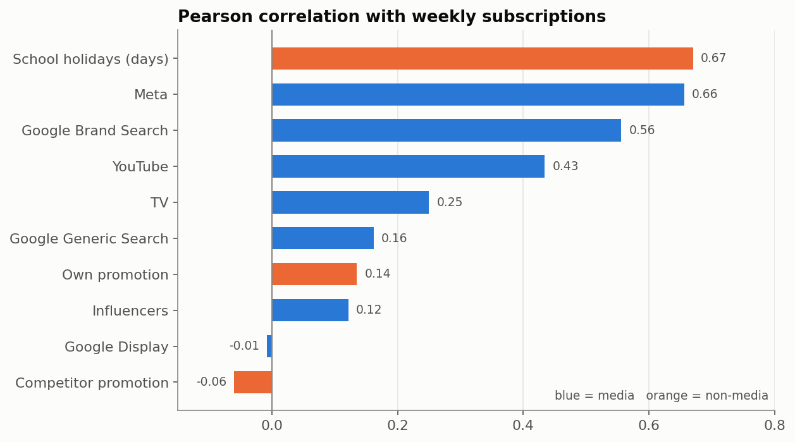
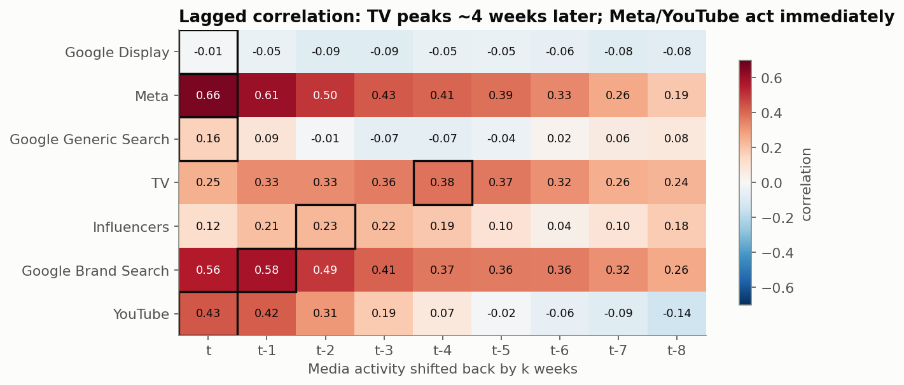
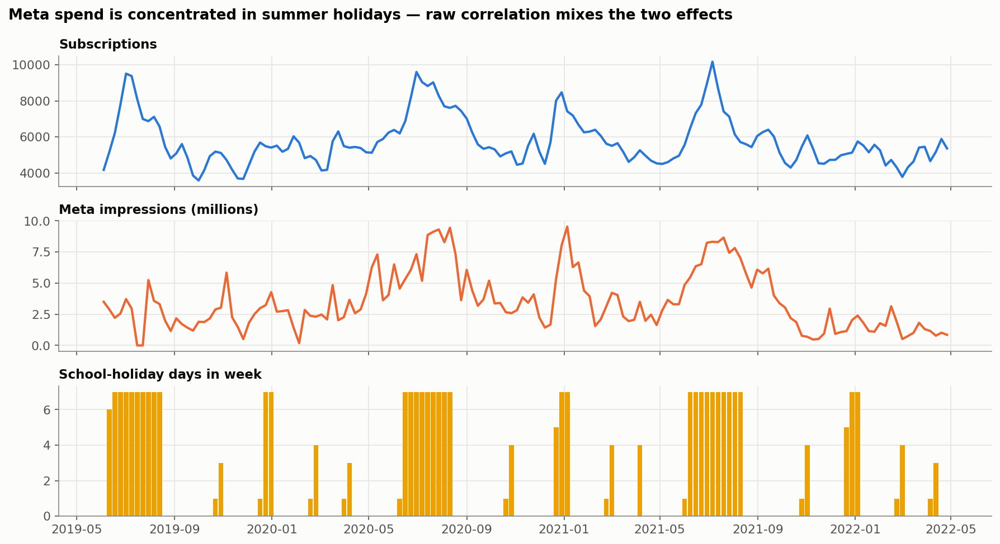
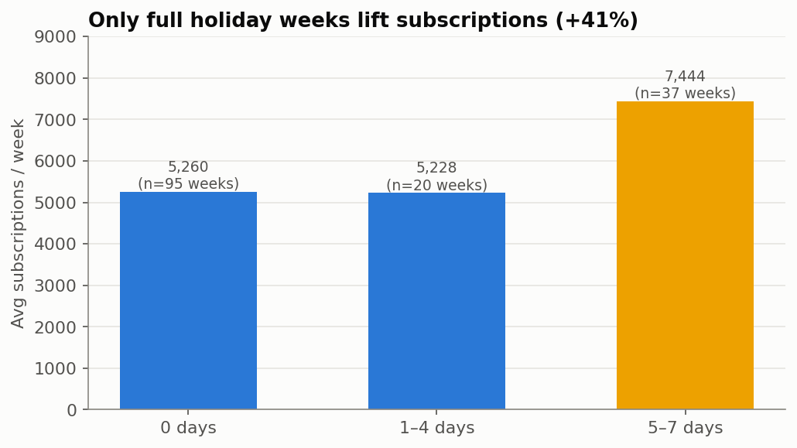
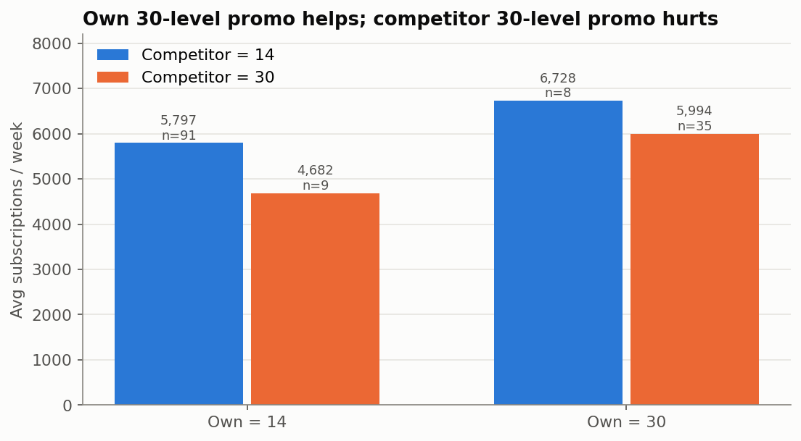
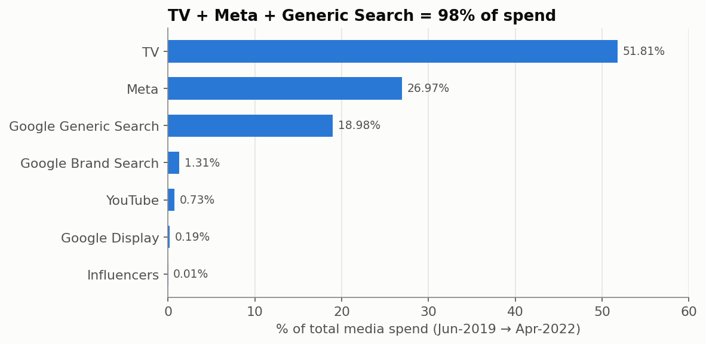
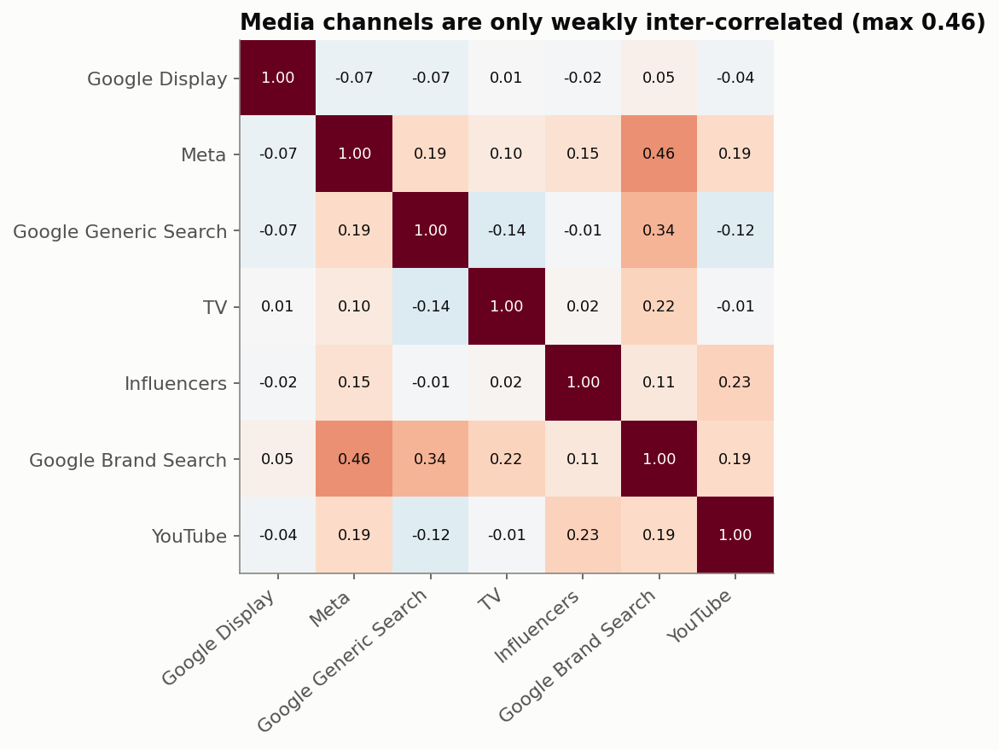
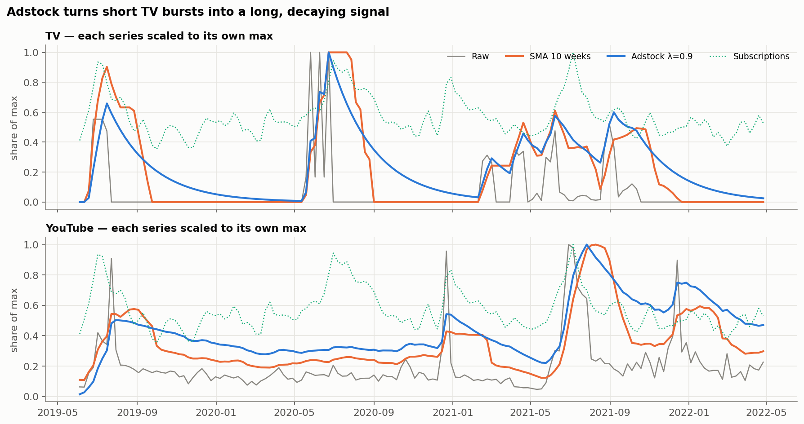
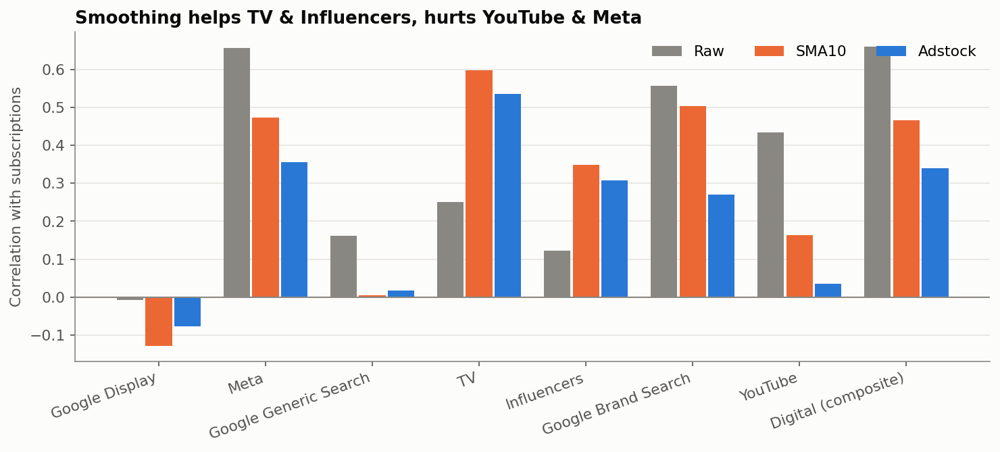
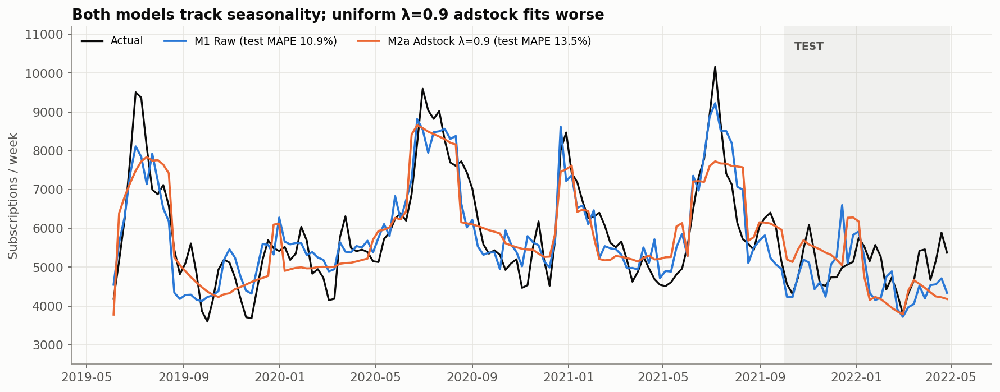
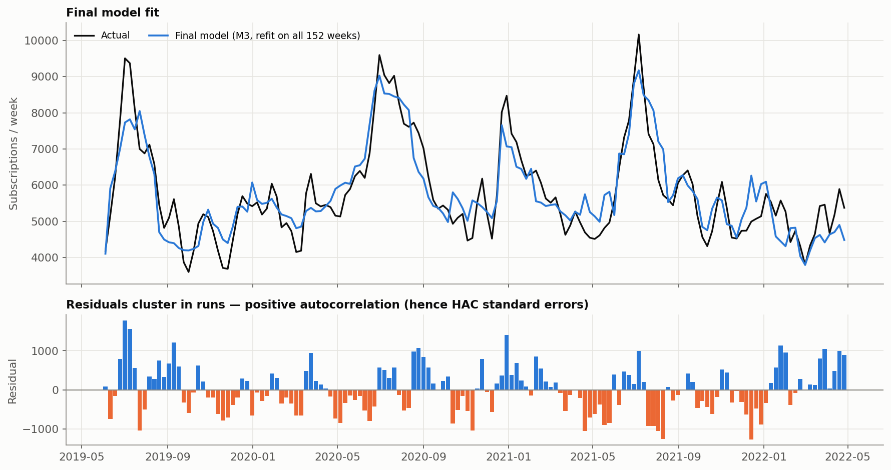

## Data & how to run

Data not included (course material from the Tomorrow Marketers AI & ML programme). The notebook `bookworm_marketing_mix_model.ipynb` shows all outputs and charts.

Tools: Python (pandas, NumPy, statsmodels, scikit-learn, matplotlib) · Google Colab

---
*Tran Bao Phuc · phuctran120116@gmail.com*
